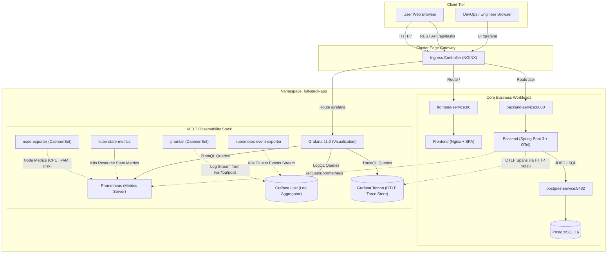
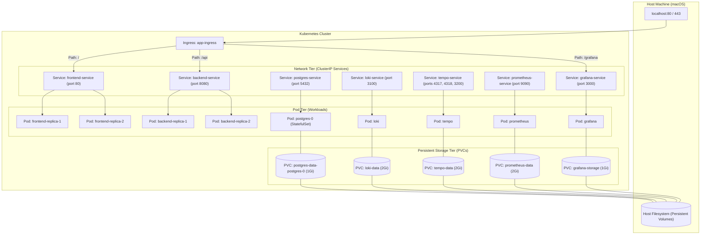
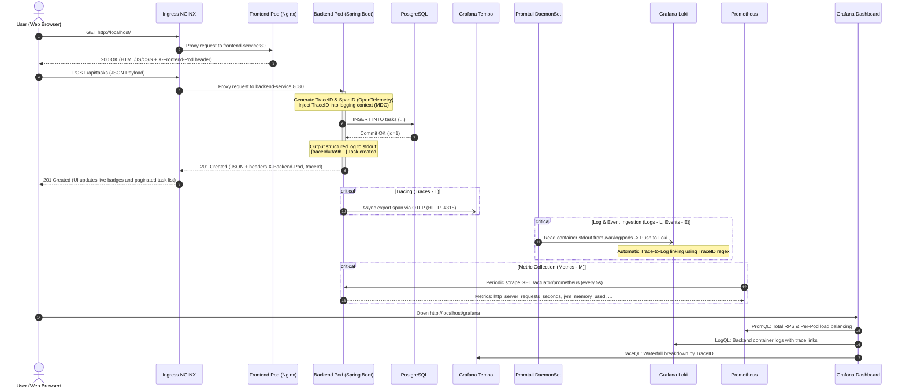

# Full-Stack Kubernetes & MELT Observability Architecture

This document describes the complete architecture of the deployed system, the physical/virtual node topology, network routing, and architectural diagrams across all layers.

---

## 1. Cluster Node Topology (Node Infrastructure)

The cluster is deployed on a local multi-node architecture consisting of **3 nodes**:

```
                        ┌─────────────────────────────────────┐
                        │   desktop-control-plane (Control)   │
                        │    Control Plane / API Server       │
                        │   (Taint: NoSchedule for app)       │
                        └──────────────────┬──────────────────┘
                                           │
                 ┌─────────────────────────┴─────────────────────────┐
                 ▼                                                   ▼
┌─────────────────────────────────┐                 ┌─────────────────────────────────┐
│         desktop-worker          │                 │        desktop-worker2          │
│      (Worker Node 1)            │                 │      (Worker Node 2)            │
│  - backend-pod-1 (Spring Boot)  │                 │  - backend-pod-2 (Spring Boot)  │
│  - frontend-pod-1 (Nginx)       │                 │  - frontend-pod-2 (Nginx)       │
│  - postgres-0 (StatefulSet+PVC) │                 │  - prometheus-pod               │
│  - loki-pod                     │                 │  - grafana-pod                  │
│  - tempo-pod                    │                 │  - kube-state-metrics           │
│  - event-exporter-pod           │                 │  - node-exporter (DaemonSet)    │
│  - node-exporter (DaemonSet)    │                 │  - promtail (DaemonSet)         │
│  - promtail (DaemonSet)         │                 │                                 │
└─────────────────────────────────┘                 └─────────────────────────────────┘
```

* **`desktop-control-plane`**: Master/Control Plane node (runs `etcd`, `kube-apiserver`, `kube-scheduler`, `kube-controller-manager`). Tainted with `NoSchedule` so application workloads are not scheduled on it.
* **`desktop-worker`** & **`desktop-worker2`**: Worker nodes. Application replicas (`backend` and `frontend`) are evenly distributed by the Kubernetes scheduler across both workers to ensure high availability and resilience.
* **`node-exporter` & `promtail` Agents**: Deployed as a `DaemonSet`, automatically running exactly one pod on **every node** in the cluster.

---

## 2. Component Diagram

The component model illustrates the logical separation between the core business application and the observability subsystem.



---

## 3. Deployment Diagram

Demonstrates how declarative Kubernetes manifests map to physical pods, services, and persistent disk storage.



---

## 4. Request & Telemetry Sequence Diagram

Illustrates the end-to-end flow of a single user action (e.g. clicking "Add Task" in the web UI) and how all 4 telemetry signals (**MELT**) are generated simultaneously.



---

## 5. Network Communication & Port Matrix

| Source | Destination | Target Port | Protocol | Purpose |
| :--- | :--- | :--- | :--- | :--- |
| **External Client** | Ingress NGINX | `80` (HTTP) | TCP / HTTP | Ingress gateway entrypoint |
| **Ingress NGINX** | `frontend-service` | `80` | TCP / HTTP | Static HTML/CSS/JS SPA routing |
| **Ingress NGINX** | `backend-service` | `8080` | TCP / HTTP | REST API (`/api/tasks`) |
| **Ingress NGINX** | `grafana-service` | `3000` | TCP / HTTP | Observability dashboard (`/grafana`) |
| **Backend Pod** | `postgres-service` | `5432` | TCP / PostgreSQL | HikariCP database connection pool |
| **Backend Pod** | `tempo-service` | `4318` | TCP / HTTP (OTLP) | OpenTelemetry distributed trace spans |
| **Prometheus** | `backend-service` | `8080` | TCP / HTTP | Actuator metrics (`/actuator/prometheus`) |
| **Prometheus** | `node-exporter` | `9100` | TCP / HTTP | Node hardware metrics (CPU, RAM, Disk) |
| **Prometheus** | `kube-state-metrics`| `8080` | TCP / HTTP | Kubernetes resource state metrics |
| **Promtail** | `loki-service` | `3100` | TCP / HTTP | Pushing `/var/log/pods` container logs |
| **Event Exporter** | `loki-service` | `3100` | TCP / HTTP | Pushing Kubernetes cluster events |
| **Grafana** | `prometheus-service`| `9090` | TCP / HTTP | Prometheus data source queries |
| **Grafana** | `loki-service` | `3100` | TCP / HTTP | Loki data source queries |
| **Grafana** | `tempo-service` | `3200` | TCP / HTTP | Tempo data source queries |
